# OSINT INVESTIGATION REPORT: Operation LOCKERGOGA

**Study case:** Operation LOCKERGOGA  
**Case source:** [ctf.osint.industries](https://ctf.osint.industries/challenges?#Operation%20LOCKERGOGA-15)  
**Case author:** EVO7  
**Date:** 04.09.2026  
**Version:** 2.0  
**Written by:** [fondgard](https://github.com/fondgard)  

**[Download Original PDF: OSINT INVESTIGATION REPORT _LOCKERGOGA_.pdf](./OSINT%20INVESTIGATION%20REPORT%20_LOCKERGOGA_.pdf)**

> **DISCLAIMER:**  
> This report is a public OSINT (Open Source Intelligence) case study based entirely on publicly available information, primarily focusing on social media intelligence (SOCMINT) and visual evidence. All active and passive reconnaissance actions described were conducted within a sterile Virtual Machine (VM) environment, routed via secure VPN/Tor networks, using sockpuppets to ensure OPSEC and non-attribution. 
> *Note: Access to any closed registries (e.g., Ukraine's open vehicle registry) demonstrated in this study was obtained via third-party aggregators. In a live corporate or official investigation, this information must be requested strictly through competent law enforcement agencies (LEA).*

---

## Contents
- [Executive Summary](#executive-summary)
- [1. Introduction](#1-introduction)
- [2. Initial Data](#2-initial-data)
- [3. Investigation Objectives](#3-investigation-objectives)
- [4. Scope and Methodology](#4-scope-and-methodology)
- [5. Analytical Section](#5-analytical-section)
  - [5.1 Analysis of Initial Data](#51-analysis-of-initial-data)
  - [5.2 Analysis of the Discovered Instagram Profile](#52-analysis-of-the-discovered-instagram-profile)
  - [5.3 Asset Analysis](#53-asset-analysis)
- [6. Conclusions](#6-conclusions)
- [7. Sources](#7-sources)
- [8. Glossary of Terms](#8-glossary-of-terms)

---

## Executive Summary
As part of the investigation into the activity of cybercriminal V. Tymoshchuk (LockerGoga), his digital footprint was analyzed, a hidden Instagram account was identified, his locations in Kyiv (up to May 2022) were geolocated, and two vehicles (Porsche, Mercedes) were identified. No recent activity has been recorded.

## 1. Introduction
29-year-old Ukrainian citizen Volodymyr Viktorovych Tymoshchuk is one of the most wanted hackers in the world. In September 2025, he was placed on the international wanted list by the US Department of Justice, the FBI [A1], and Europol [A1]. For information leading to his capture, the FBI offered a reward of up to $10 million USD [A1]. Tymoshchuk V. V. faces charges of administering major ransomware networks, which caused damages exceeding $18 billion. The most notable ransomware program associated with Tymoshchuk's name is the "LockerGoga" virus, which attacked corporate IT infrastructures worldwide in March 2019. [1] [2]

Currently, Tymoshchuk V. V. retains the status of a wanted fugitive. Through joint operations by law enforcement agencies of the US, Netherlands, Switzerland, United Kingdom, Norway, Germany, France, and Ukraine [A1], several of his accomplices have been arrested. [3] [4] [5]

## 2. Initial Data

| Attribute | Details |
| :--- | :--- |
| **Full Name** | Tymoshchuk Volodymyr Viktorovych Тимощук Володимир Вікторович Тимощук Владимир Викторович |
| **Crime** | Cybercrimes |
| **Wanted by** | FBI (USA), Europol |
| **Classification** | Most Wanted |
| **Sex** | Male |
| **Date of birth, age** | 02.10.1996, 29 years old |
| **Place of birth** | Ukraine |
| **Citizenship** | Ukrainian |
| **Aliases** | "Boba", "MSFV", "Deadforz", "Farnetwork" |
| **Languages** | Russian, Ukrainian |
| **Hair color** | Black or brown |
| **Eyes** | Brown |
| **Weight** | 77-86 kg |
| **Height** | 180-185 cm |

*Table 1: Initial data on suspect Volodymyr Viktorovych Tymoshchuk [6][7]*

## 3. Investigation Objectives
* Identification and analysis of digital infrastructure (accounts)
* Identification and analysis of potential assets (vehicles)
* Analysis of potential internet posts to establish the locations where they were made

## 4. Scope and Methodology
This report relies on publicly available information, primarily focusing on social media intelligence (SOCMINT) and visual evidence. The investigative methodology consists of four main phases:

* **Alias Pivoting and Discovery:** Utilizing initial identifiers from law enforcement notices to conduct targeted search queries and deploy automated username checking tools across digital platforms.
* **Digital Footprint Verification:** Leveraging search engine caches and web archives to uncover hidden accounts and verify the authenticity of identified profiles.
* **Visual Geolocation (IMINT):** Cross-referencing visual artifacts from uploaded media (e.g., vehicle dashboards, road infrastructure, building interiors) with mapping services and stock imagery to pinpoint the target's exact coordinates and timelines.
* **Asset Identification:** Extracting identifying details from visual evidence (e.g., vehicle models, license plates) and querying open vehicle registries to determine asset specifications and registration data.

**Operational Security (OPSEC):** All investigative actions, including active and passive reconnaissance, were conducted within a sterile Virtual Machine (VM) environment. Traffic was routed via secure VPN/Tor networks, and engagement with target platforms was performed strictly utilizing legend-building identities (sockpuppets) to ensure non-attribution and prevent exposure.

## 5. Analytical Section

### 5.1. Analysis of Initial Data
On September 2, 2026, at the start of the investigation, wanted notices for Volodymyr Tymoshchuk issued by the US Federal Bureau of Investigation [A1] and Europol [A1] were analyzed. [6] [7] A list of Tymoshchuk's potential aliases (specifically "Boba", "MSFV", "Deadforz", and "Farnetwork") was selected as the initial lead for searching. The hypothesis was formed that he might have used some of these aliases when creating social media accounts. However, through various search queries using these aliases, no accounts were discovered [B2].

   
*Figure 1. Examples of search queries applied*

As a result of search queries and the use of automated open-profile search tools (OSINT username checkers) [B2], a number of potential accounts belonging to Tymoshchuk were established [B2].
During further analysis, media publications were examined that could lead to an information trail on Volodymyr Tymoshchuk. According to information from the "Institute of Mass Information" resource [B2], on September 9, 2025, he was placed on Europol's wanted list at the initiative of the Paris Prosecutor's Office (France) [A1]. [1]

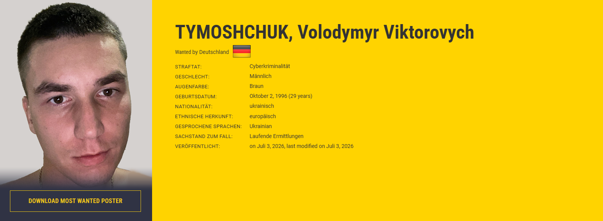
*Figure 2. Europol wanted notice for Volodymyr Tymoshchuk, 2026*

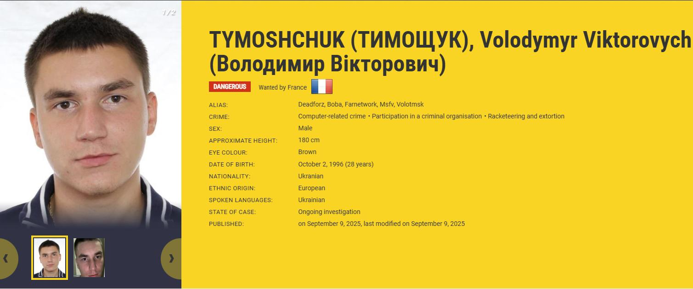
*Figure 3. Europol wanted notice for Volodymyr Tymoshchuk, 2025*

Since the information from the screenshot attached to this article (see Figure 3) differed from what was already available (see Figure 2), a verification of the attached image's authenticity was conducted. Consequently, references to the information in the image were identified on several other independent resources, notably 20 Minuten [B2] and TechRadar [B2]. [8] [9] The page displaying Europol's initial wanted notice from France was additionally partially recovered using the web.archive.org service [B1], which definitively confirmed its authenticity [A1]. [10]

Analysis of German police resources [A1] established that in June 2026, the management of Tymoshchuk's Europol wanted case was transferred to the State Criminal Police Office of Baden-Württemberg [A1], resulting in updates to the Europol page [A1]. [7] [11] [12]

Both Europol pages were compared to identify the changes made. As a result, the now-removed alias "Volotmsk" was discovered on the older wanted notice [A1]. This identifier was used for dorking queries [B2], leading to the discovery of a cached entry for an Instagram account mentioning the alias [B2]. Consequently, a hypothesis was formulated regarding Tymoshchuk's ownership of this account [C3]. Using standard URL structures for Instagram accounts, the profile itself was uncovered (see Figures 4-6) [B2]. [13]

   
*Figure 4. Search query using the alias "Volotmsk"*

   
*Figure 5. Source from instagram.com found via query, containing a mention of the alias*

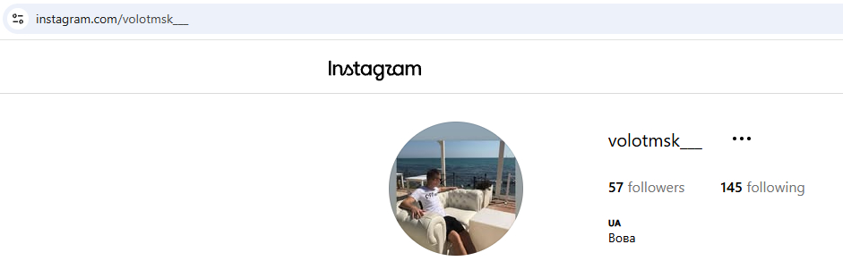   
*Figure 6. Discovered Instagram profile matching Tymoshchuk [13]*

### 5.2. Analysis of the Discovered Instagram Profile
The Instagram profile `@volotmsk___` is a public profile registered in March 2017 [C3]. The account country is Ukraine; the bio lists UA (country code for Ukraine) and the owner's name Vova (Volodymyr) [C3]. The profile picture depicts a man sitting on a sofa by the seaside. He has short hair and is wearing a white tank top and black shorts. Due to low image quality and camera angle, precisely matching this photo with other known photographs of Volodymyr Tymoshchuk is not feasible [C3]. The account contains 3 stories and 4 regular posts. The most recent publication dates to May 25, 2022 [C3]. [13]

The earliest available publication on Tymoshchuk's suspected profile was a story video posted in April 2021 [C3].

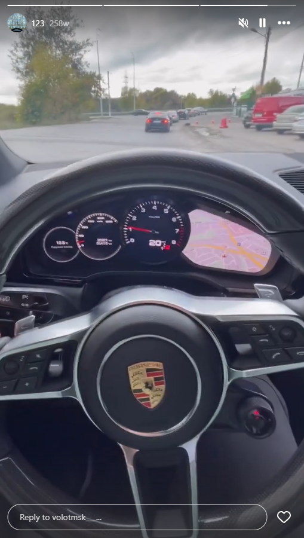   
*Figure 7. Video frame posted by Tymoshchuk*

Analysis of the video footage established that filming took place from the driver's seat of a Porsche vehicle in urban traffic conditions [B2]. Initial frames capture a vehicle following behind in the rearview mirror (a black Mercedes Benz E-Class) after which the camera shifts to oncoming traffic [B2]. Background music plays inside the car. The instrument cluster is also visible in the shot. According to dashboard readings, total mileage is 36,921 km, and trip mileage is 2,547 km (see Figures 7, 8) [B2]. Additionally, information from the center console display revealed the exact recording time is 16:22 (see Figure 9) [B2].

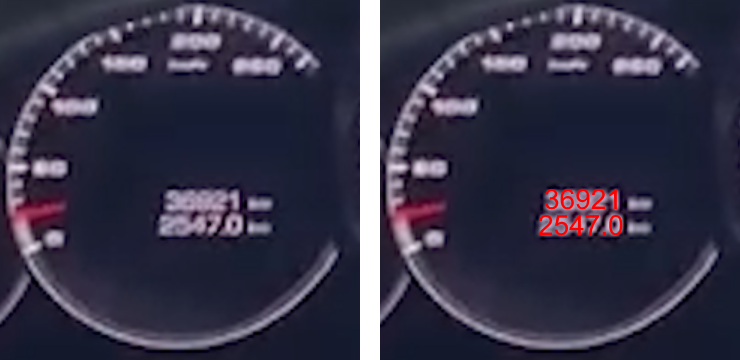   
*Figure 8. Breakdown of odometer readings*

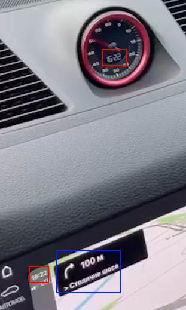   
*Figure 9. Information from the vehicle center display: red - time, blue - geolocation*

The post lacks geotags or other explicit mentions of the filming location. The primary clue for establishing the location was a directional sign on the vehicle's navigation screen interface [B2]. According to the screen, the driver needed to make a right turn onto "Столичне шосе" (Stolychne Highway) in 100 meters (see Figure 9) [B2]. As a secondary clue to confirm the location, the road infrastructure layout from the navigation display was cross-referenced with Google Maps (see Figure 10) [B2].

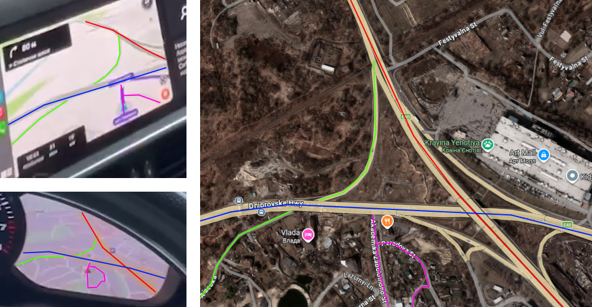
*Figure 10. Correlation of navigation display interface with Google Maps: left - video frames, right - Google Maps*

Thus, the precise recording location of the video was identified at coordinates: `≈50.33957, 30.54483` [B2].

On the same day in September 2021, two story posts were published [C3]. Both photographs were taken in the same location and feature a black Mercedes Benz E-Class W213, presumably the same vehicle seen previously [C3]. In the first photo, the vehicle is pictured parked on a hill from a distance. The second photo is taken from the driver's perspective, showing a view over a lake or wide river [C3].

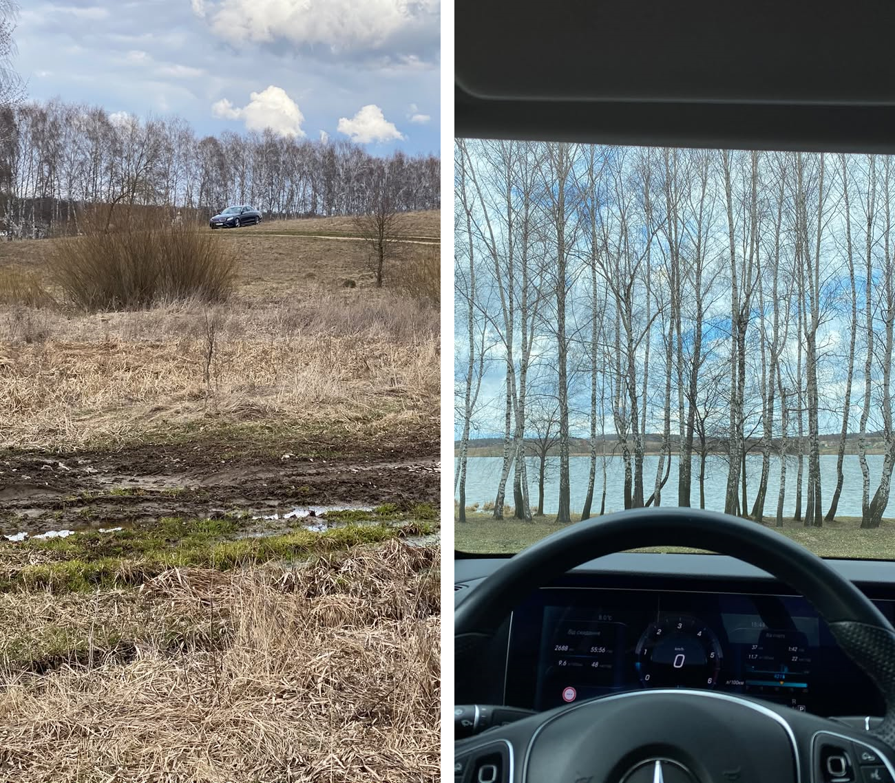
*Figure 11. Story photos from Tymoshchuk's suspected account*

According to the vehicle dashboard readings, the ambient temperature was 8°C [C3]. Trip stats indicate 2,688 km driven over 55:56 hours, with average fuel consumption at 9.6 L/100km and average speed at 48 km/h [C3]. Exact geolocation cannot be determined from these two photos alone; suspected location is Kyiv Region [C3].

On October 5, 2021, two photos geotagged in Kyiv were uploaded [C3]. The first photo depicts a man (presumably Volodymyr Tymoshchuk) with a dark-haired woman in a restaurant [C3]. The man in the photo points to his ring finger bearing a ring; the post is captioned "💍" [C3]. The second photo shows the familiar Porsche Cayenne [C3]. The car is parked near a building decorated with string lights. The captured building is presumed to be the restaurant where the first photo was taken [C3].

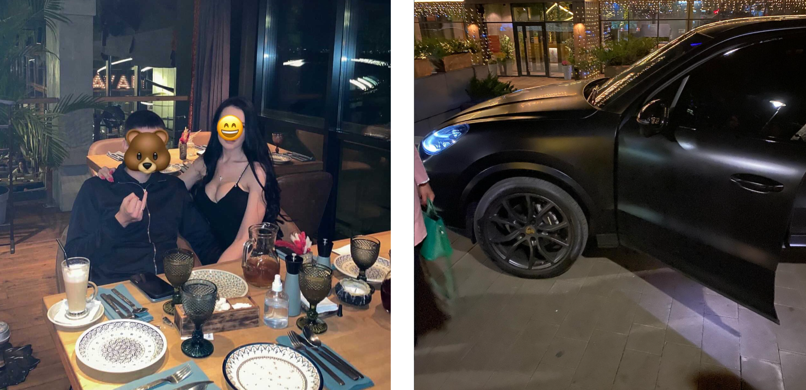
*Figure 12. Photos from Tymoshchuk's suspected account dated 05.10.2021*

Because reverse image searches yielded no results, the Kyiv geotag and background signage were used as pivot points [B2]. A Google query for Kyiv restaurants containing "AVA" returned two candidates: Avalon and Havana [B2]. Analyzing Google Maps photos from Havana restaurant revealed key matching details [B2]. Signage and glassware styling in the Instagram photo match a photo uploaded by user "Andrii Piddubnyak" at Havana (see Figure 13) [B3]. The second photo featuring the car matches the panorama across from the restaurant uploaded by user "Mikhail Protsenko" (yellow and pink lines indicate vehicle alignment relative to the panorama view, see Figure 14) [B3]. Thus, the exact location was confirmed as Havana Restaurant (Kyiv, Naberezhne Hwy 28), coordinates: `≈50.42795, 30.57024` [B2].

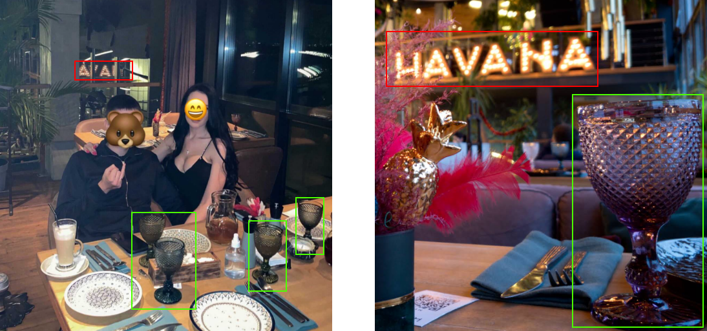
*Figure 13. Comparison of Instagram photo (left) with Google Maps photo (right) [14]*

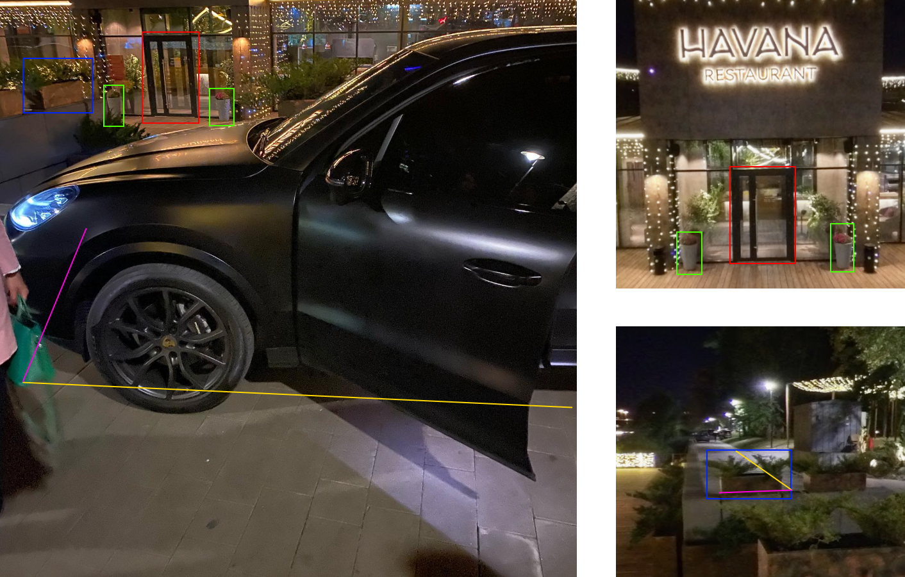
*Figure 14. Comparison of Instagram photo (left) with panoramic sections from Google Maps (right) [15]*

On January 16, 2022, a photo geotagged in Kyiv appeared showing a Mercedes Benz E-Class W213 parked by a reservoir [C3]. Based on the geotag and body of water size, the Kyiv Reservoir area is considered a working hypothesis [C3]. However, exact location verification is not possible due to a lack of distinct visual landmarks [C3].

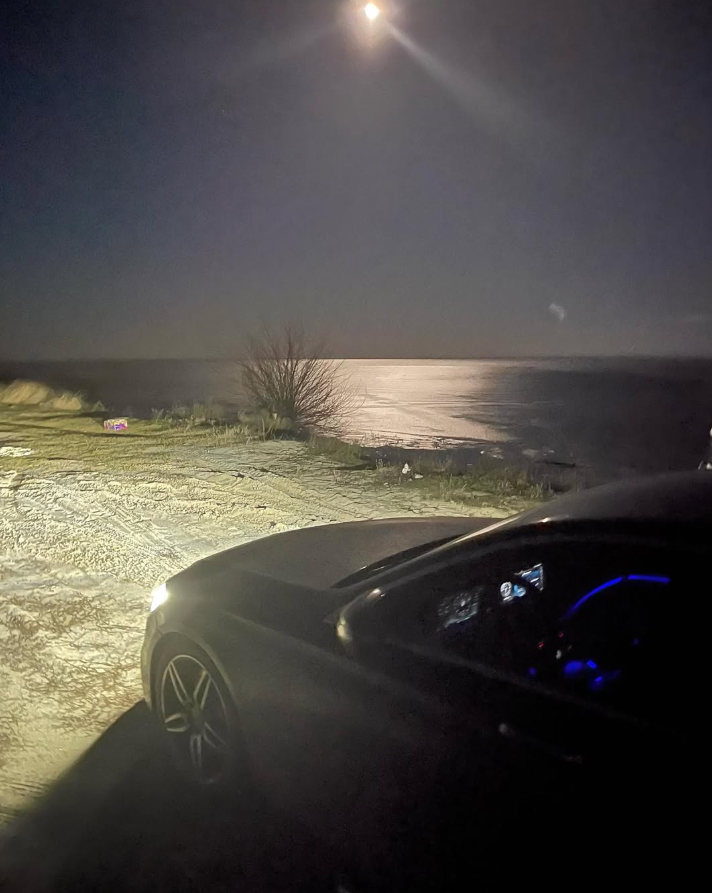   
*Figure 15. Instagram post dated 16.01.2022*

On May 25, 2022, account `@volotmsk___` published its final photo [C3]. It features a Porsche Cayenne parked on a roadside, showing license plate [REDACTED] [C3]. Destroyed Russian military equipment is visible in the background [C3]. Visual background analysis using Google Lens identified a matching location on Alamy stock photos (see Figure 16) [B2]. [16] The location was identified as "Dmytrivka, memorial site" in the Bucha District west of Kyiv, a memorial honoring fallen defenders of Ukraine during the Russian invasion of Ukraine [B2].

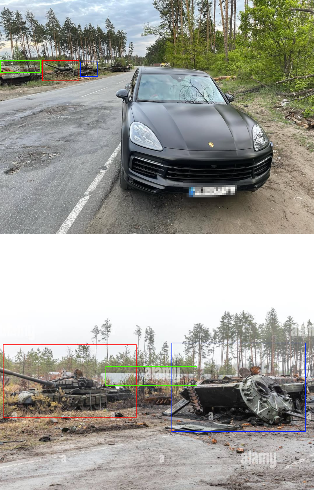   
*Figure 16. Instagram post (top) compared with Alamy photo (bottom) [16]*

### 5.3. Asset Analysis
On September 4, 2026, the investigation proceeded to analyze assets previously discovered through Volodymyr Tymoshchuk's suspected social media profiles. The primary suspected asset was a Porsche Cayenne vehicle, repeatedly appearing on Tymoshchuk's suspected Instagram profile (see Figure 17) [C3].

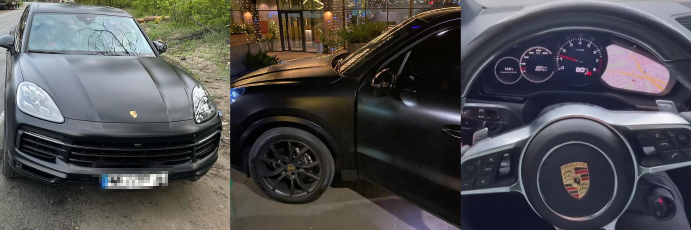
*Figure 17. Porsche Cayenne vehicle*

The license plate of this vehicle served as the foundation for querying vehicle records. Consequently, a record page for this vehicle was located on the "UNDA Universal Independent Vehicle Diagnostics" website, containing data sourced from Ukrainian Ministry of Internal Affairs databases [B2]. [17]

*Note: Within this Case Study, access to Ukraine’s open vehicle registry was obtained via a third-party aggregator. In a live corporate investigation, this information would be requested strictly through competent law enforcement agencies (LEA).*

| Attribute | Details |
| :--- | :--- |
| **Vehicle License Plate** | [REDACTED] |
| **VIN** | [REDACTED] |
| **Make, Model** | PORSCHE CAYENNE |
| **Year of Manufacture** | 2019 |
| **Registration Address** | [REDACTED] |
| **Owner** | INDIVIDUAL |
| **Data Recency** | Current as of May 1, 2026 |

*Table 2: Vehicle Registration Data*

The next target of analysis was a Mercedes Benz E-Class vehicle, also appearing repeatedly on Volodymyr's suspected profile [C3]. It is impossible to determine the license plate from the publications [C3]. Nevertheless, photographs confirm the model as a W213, produced from 2016 onward (see Figure 18) [B2].

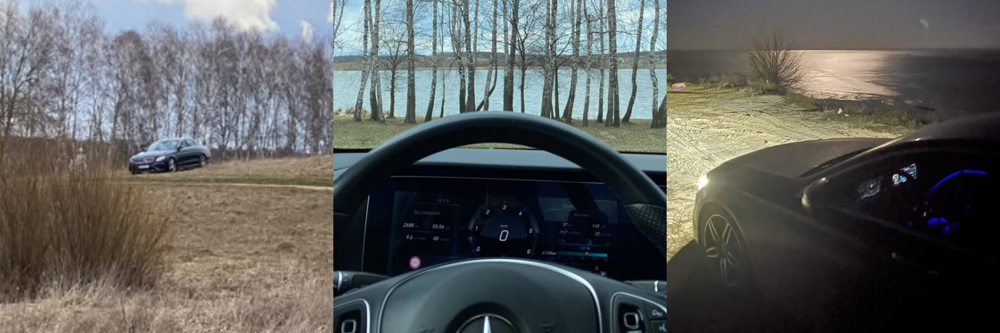
*Figure 18. Mercedes Benz vehicle*

## 6. Conclusions
The investigation uncovered various accounts and identifiers, several of which belong to Volodymyr Tymoshchuk with a high degree of probability. Additionally, potential assets belonging to him were identified and analyzed.

Full analysis of Volodymyr Tymoshchuk's digital footprint confirmed his presence in Ukraine prior to 2022. An October 5, 2021 post on his suspected Instagram account contains indicators suggesting an engagement. According to other posts, the account owner maintained an interest in vehicles and likely owned a Porsche Cayenne. A Mercedes Benz E-Class W213 vehicle was also tied to the account as a potential asset. The last identified post on the account is dated May 25, 2022. No subsequent activity for this account was discovered during this research. Consequently, definitive conclusions regarding Tymoshchuk's current location or reasons for activity cessation cannot be made. Volodymyr continues to evade international law enforcement, with active search efforts ongoing.

## 7. Sources
1. **Інститут масової інформації (Institute of Mass Information)**, article "США обіцяють $10 млн за інформацію про лідера міжнародного хакерського угруповання" - [Link](https://imi.org.ua/news/ssha-obitsyayut-10-mln-za-informatsiyu-pro-lidera-mizhnarodnogo-hakerskogo-ugrupovannya) *(Access date: 04.09.2026)*
2. **Slavic Sacramento**, article "ФБР разыскивает украинского хакера, назначена награда до $10 млн" - [Link](https://www.slavicsac.com/2025/09/09/volodymyr-viktorovych-tymoshchuk/) *(Access date: 04.09.2026)*
3. **Europol**, article "12 targeted for involvement in ransomware attacks against critical infrastructure" - [Link](https://www.europol.europa.eu/media-press/newsroom/news/12-targeted-for-involvement-in-ransomware-attacks-against-critical-infrastructure) *(Access date: 04.09.2026)*
4. **European Union Agency for Criminal Justice Cooperation**, article "Ransomware group dismantled in Ukraine in a major international operation supported by Eurojust and Europol" - [Link](https://www.eurojust.europa.eu/news/ransomware-group-dismantled-ukraine-major-operation-supported-eurojust-europol) *(Access date: 04.09.2026)*
5. **Europol**, article "New fugitive uploaded to EU Most Wanted list for major ransomware attacks" - [Link](https://www.europol.europa.eu/media-press/newsroom/news/new-fugitive-uploaded-to-eu-most-wanted-list-for-major-ransomware-attacks) *(Access date: 04.09.2026)*
6. **FBI** (official US FBI resource), wanted information for Tymoshchuk V. V. - [Link](https://www.fbi.gov/wanted/cyber/volodymyr-viktorovych-tymoshchuk) *(Access date: 04.09.2026)*
7. **EU Most Wanted** (official Europol resource), wanted information for Tymoshchuk V. V. - [Link](https://eumostwanted.eu/de#/de/tymoshchuk-volodymyr-viktorovych) *(Access date: 04.09.2026)*
8. **20 Minuten**, article "FBI jagt Super-Hacker «Boba» - Kopfgeld von 10 Mio. Dollar" - [Link](https://www.20min.ch/story/firmen-erpresst-fbi-jagt-super-hacker-boba-kopfgeld-von-10-mio-dollar-103418182) *(Access date: 04.09.2026)*
9. **TechRadar**, article "$10 million bounty issued by US DOJ for ransomware kingpin responsible for $18 billion of damage" - [Link](https://www.techradar.com/pro/security/usd10-million-bounty-issued-by-us-doj-for-ransomware-kingpin) *(Access date: 04.09.2026)*
10. **web.archive.org** (Internet Archive), archived "EU Most Wanted" page - [Link](https://web.archive.org/web/20251108222029/https://eumostwanted.eu/index.php/fr#/index.php/tymoshchuk-timoschuk-volodymyr-viktorovych-volodimir-viktorovich) *(Access date: 04.09.2026)*
11. **Generalstaatsanwaltschaft Karlsruhe** (Karlsruhe General Prosecutor's Office), hacker wanted notice - [Link](https://generalstaatsanwaltschaft-karlsruhe.justiz-bw.de/pb/Lde/Startseite/Presse/PM+vom+10_09_25/?LISTPAGE=1222232) *(Access date: 04.09.2026)*
12. **Polizei Baden-Württemberg** (official Baden-Württemberg police resource), wanted page for Tymoshchuk V. V. - [Link](https://fahndung.polizei-bw.de/tracing/fahndung-nach-fluechtigem-straftaeter/) *(Access date: 04.09.2026)*
13. **Instagram**, profile `@volotmsk___` - [Link](https://www.instagram.com/volotmsk___) *(Access date: 04.09.2026)*
14. **Google Maps**, photo of "Havana" restaurant - [Link](https://maps.app.goo.gl/9BxdYsHAvHU5J5Zq5) *(Access date: 04.09.2026)*
15. **Google Maps**, photo of "Havana" restaurant - [Link](https://maps.app.goo.gl/VvyqSqtDkYXsbZMi9) *(Access date: 04.09.2026)*
16. **Alamy**, stock photography - [Link](https://www.alamy.com/bucha-ukraine-02nd-apr-2022-broken-tanks-and-combat-vehicles-of-the-russian-invaders-seen-near-the-village-of-dmitrievka-credit-sopa-images-limitedalamy-live-news-image466523670.html) *(Access date: 04.09.2026)*
17. **Ukrainian Ministry of Internal Affairs database**, vehicle license plate search tool - [REDACTED] *(Access date: 04.09.2026)*

## 8. Glossary of Terms
* **OSINT (Open Source Intelligence)** - intelligence discipline involving the collection and analysis of data gathered from open sources.
* **Ransomware** - a type of malicious software designed to encrypt a victim's files and demand a ransom payment for decryption.
* **Most Wanted** - a list of high-priority fugitives whose apprehension is prioritized by law enforcement agencies.
* **Digital Footprint** - the body of traceable digital activity and data left by an individual on the internet.
* **Identifier** - a unique feature or data point allowing an entity to be uniquely identified.
* **Selector** - a specific identifier utilized as the basis for targeted searches.
* **Alias** - an assumed name used to register accounts and conceal true identity online.
* **Dorks** - specialized search engine queries utilizing advanced operators and search filters.
* **Admiralty Scale** - a standardized intelligence evaluation system (NATO Admiralty Scale) used to assess source reliability (letters A through F) and information credibility (numbers 1 through 6).
* **Cache** - stored data snapshots of content that may have been altered or deleted. In search contexts, search engine cache refers to stored web page data associated with specific queries.
* **Web Archive** - a digital repository service capturing and storing historical snapshots of web pages over time.
* **Snapshot** - a specific archived copy of a web page preserved by a web archiving service.
* **Geolocation** - geographic coordinates determining the physical location of an object or event.
* **Geotag** - location metadata attached to media or posts in social networks indicating where content was captured.
* **Reverse Image Search** - an OSINT technique used to identify image sources, matching variants, or context using computer vision tools (e.g., Google Lens).
* **VIN** - Vehicle Identification Number; a unique 17-character code used by the automotive industry to identify individual motor vehicles.
* **Username** - a unique handle used to identify a user account across digital platforms.
* **Account ID** - a unique numerical string assigning identity to an account within a system.
* **URL** - Uniform Resource Locator; a web address pointing to a specific online resource or file.
